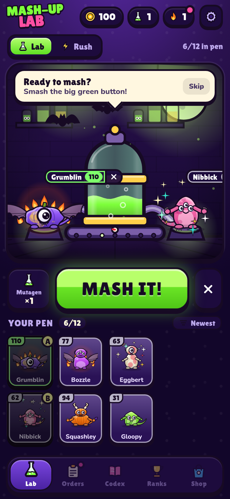
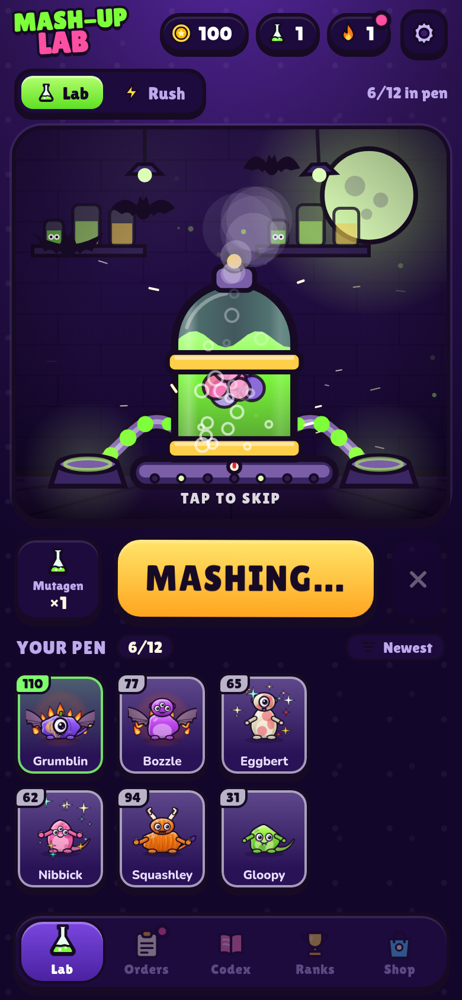
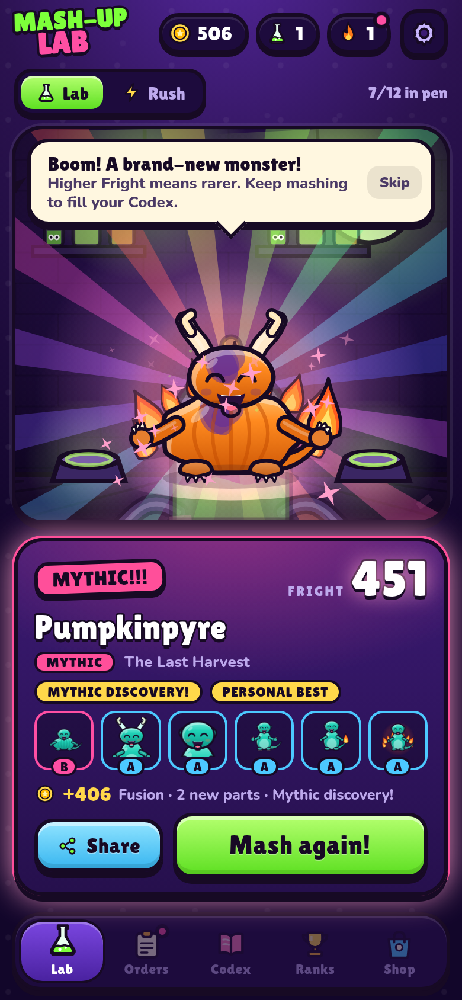
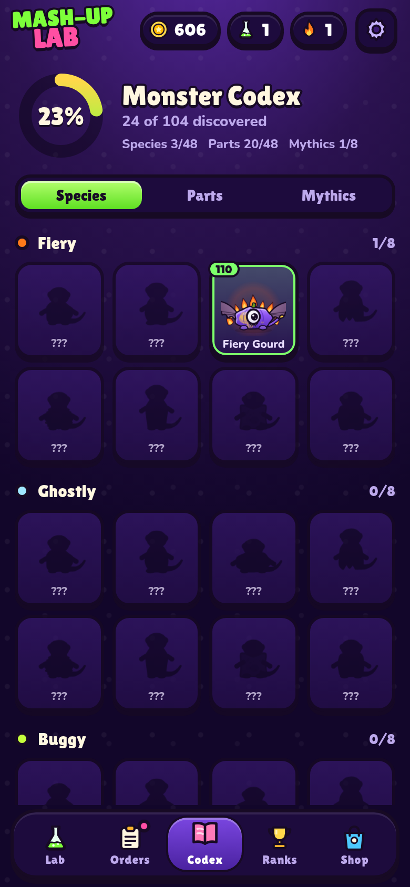
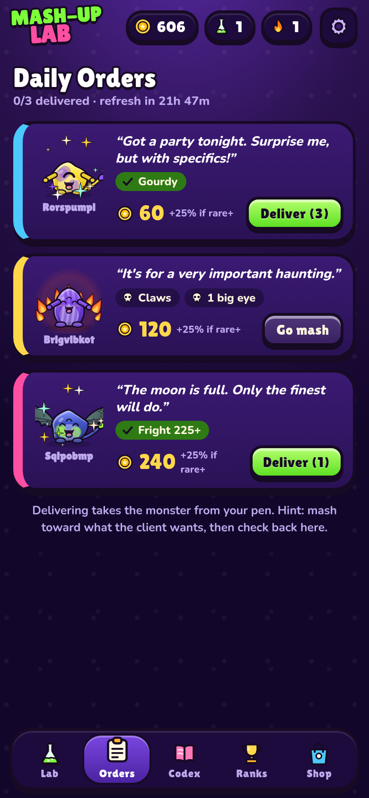
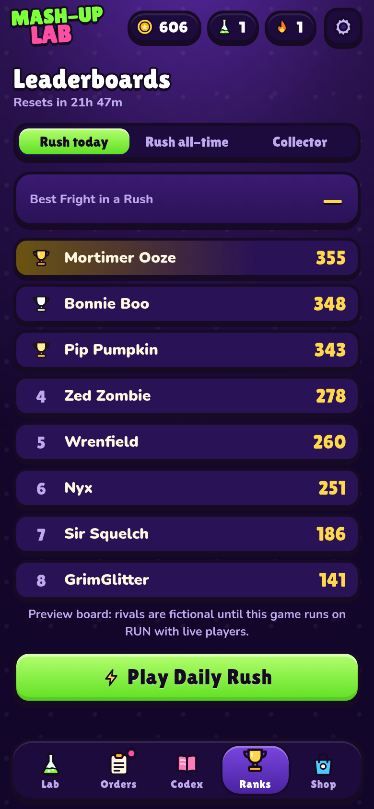
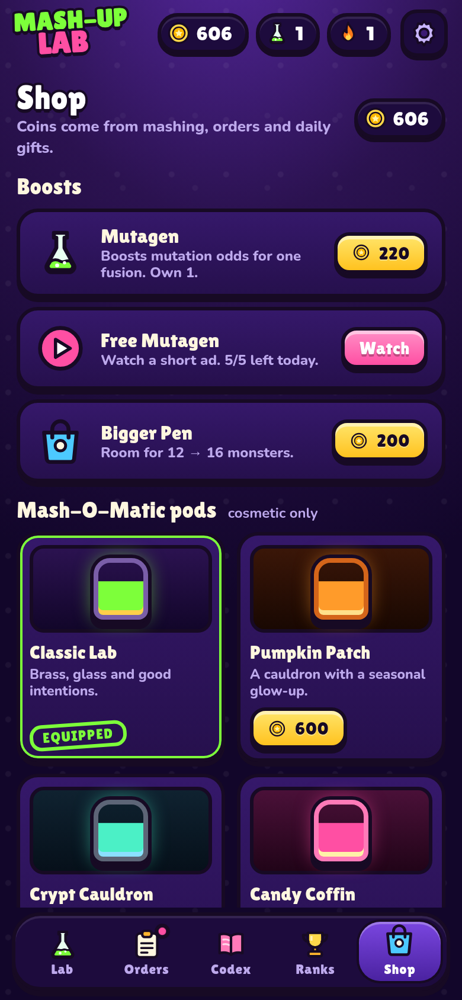
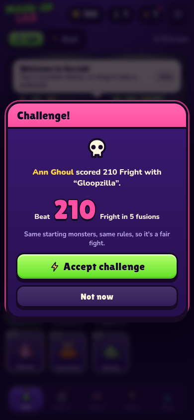

# MASH-UP LAB

> Fuse. Reveal. Collect. A cartoon-gothic monster-fusion collector for the **RUN October Jam** (theme: *Monster Mash*).

Drag two monsters into the **Mash-O-Matic**. It shakes, splatters goo, and after a five-second suspense build it reveals a **brand-new creature**: procedurally drawn, with a generated name, a rarity and a **Fright score**. Chase mythic recipes, fill the Codex, deliver Daily Orders, and send friends a "beat my Fright score" challenge.

| Lab | Mash | Reveal | Codex |
| --- | --- | --- | --- |
|  |  |  |  |

| Daily Orders | Leaderboards | Shop | Challenge link |
| --- | --- | --- | --- |
|  |  |  |  |

Desktop: [lab](screenshots/desktop-03-ready.png) · [reveal](screenshots/desktop-05-reveal.png) · [codex](screenshots/desktop-07-codex.png)

## Features

- **Fusion engine.** 48 hand-built parts over 6 slots (body, head, eyes, limbs, tail, aura) in 6 themes. Children inherit from both parents, mutate, pick up colour/pattern/size/shiny traits, and score **Fright** with theme-synergy bonuses. 5 rarities from Common to Legendary, plus 8 hidden **Mythic** recipes.
- **Everything is drawn in code.** Creatures are rendered with Canvas2D paths, so every one is unique and nothing is copyrighted art. Procedural WebAudio SFX and a 108 BPM music loop, with no audio files.
- **The reveal.** 5-second fusion with shake, steam, goo splatter, camera push and a jackpot burst on rare+ results. Tap to skip, with a reduced-motion mode.
- **Codex.** 104 entries (48 species, 48 parts, 8 mythics) with completion %, silhouettes for undiscovered entries and recipe hints.
- **Daily Orders.** Three customers a day want specific traits for coins. Resets at 00:00 UTC.
- **Streaks and gifts.** Daily gift with a growing streak bonus.
- **Fright Rush.** A 5-fusion score attack with the same starting monsters for everybody that day. Two free attempts a day; a rewarded ad or a coin purchase gets you more. Never a hard wall.
- **Challenges.** Share a creature card (1080x1350 image) or a seeded challenge link (`?c=1&s=<seed>&t=<score>`). Whoever opens it plays the exact same Rush and sees whether they beat your score.
- **Leaderboards.** Daily and all-time boards for Rush and Collector modes via the RUN SDK.
- **Fair monetization.** Cosmetic Mash-O-Matic skins (coins, or real-money via RUN shop) and an optional rewarded ad for a mutagen boost. Everything degrades gracefully if Shop / Ads / Purchases are unavailable.
- **Tutorial** in the first 30 seconds with a guaranteed exciting first fusion.
- **Mobile-first**, safe-area aware, 60 fps, desktop layout with a side dock, keyboard accessible and reduced-motion friendly.

## Tech

React 19 · TypeScript (strict) · Vite 8 · `motion` · Canvas2D · WebAudio · [`@series-inc/rundot-game-sdk`](https://www.npmjs.com/package/@series-inc/rundot-game-sdk) 5.x.

- The game logic (`src/core`) is pure, seeded and unit-tested (45 Vitest tests): genomes, fusion, Fright, naming, mythic recipes, orders, economy, Rush.
- All persistence goes through the SDK's app storage. There is no `localStorage`/IndexedDB in game code and no external backend or API.
- Every SDK call is wrapped so a failing host never crashes the game (`src/platform/sdk.ts`).
- Outside RUN the SDK runs in its built-in **MockHost**, so the game is fully playable in any browser.

## Run it

```bash
npm install
npm run dev        # http://localhost:5173
npm test           # vitest
npm run build      # typecheck + production build in dist/
npx rundot predeploy --phase all   # offline RUN deploy checks
```

QA scripts (need Chrome/Chromium; they drive the dev server with Playwright):

```bash
node scripts/qa-shots.mjs  http://127.0.0.1:5173/ /tmp/qa    # full-flow screenshots, mobile + desktop
node scripts/qa-flows.mjs  http://127.0.0.1:5173/ /tmp/qaf   # drag/drop, pen-full swap, orders, challenge link, rush, reduced motion
node scripts/qa-extra.mjs  http://127.0.0.1:5173/ /tmp/qax   # touch drag, short phone
```

## Project layout

```
src/core/      pure game rules (genome, fusion, fright, names, recipes, orders, rush, state) + tests
src/art/       Canvas2D creature renderer, thumbnails, share-card renderer
src/stage/     the Mash-O-Matic canvas: machine, goo, particles, reveal choreography
src/audio/     procedural WebAudio SFX + music
src/platform/  safe wrappers around the RUN SDK (storage, leaderboard, shop, ads, sharing, haptics)
src/app/       external store + every game action
src/ui/        React UI (lab, tabs, modals, kit)
rundot/        leaderboard + shop server config for RUN
```

## Limitations

- A Rush run lives in memory: closing the app mid-run forfeits that attempt.
- Leaderboards and the shop only return live data inside RUN; in a plain browser they show an empty board / the coin-only shop.
- Challenge links carry the seed and target in the URL; they are fair-play, not tamper-proof.

## Credits and license

All art, code and audio are original and generated at runtime. MIT licensed, see [LICENSE](LICENSE). Not affiliated with any existing franchise; no copyrighted characters or music are used.
